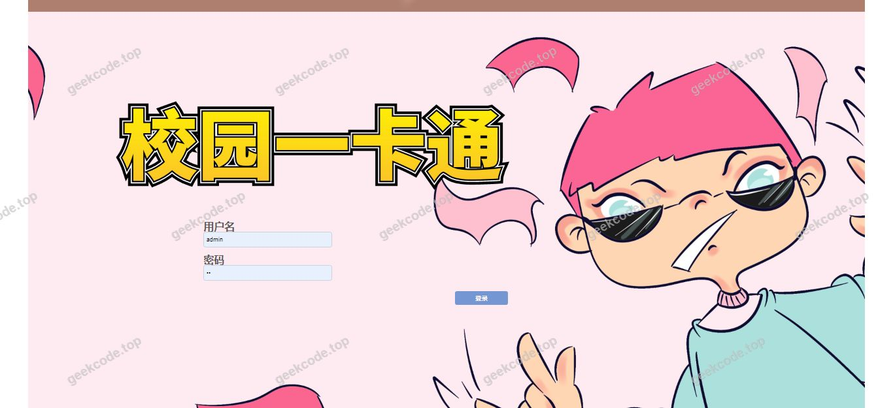
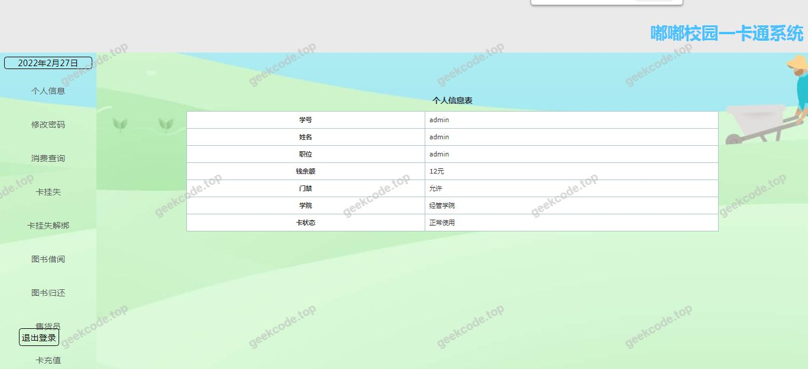
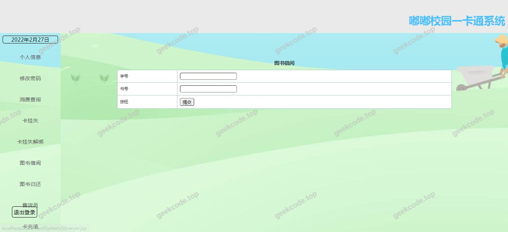
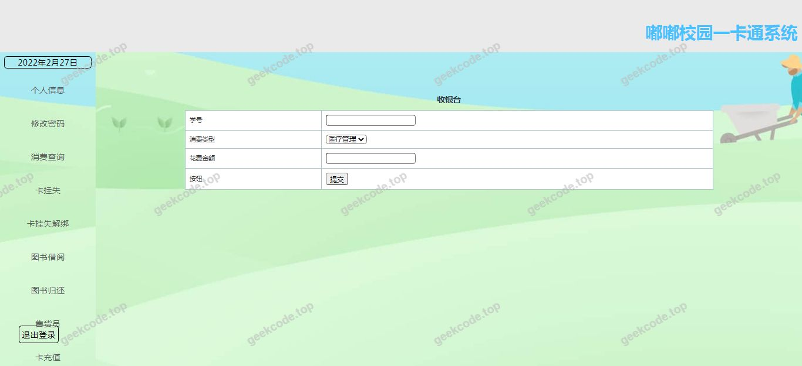
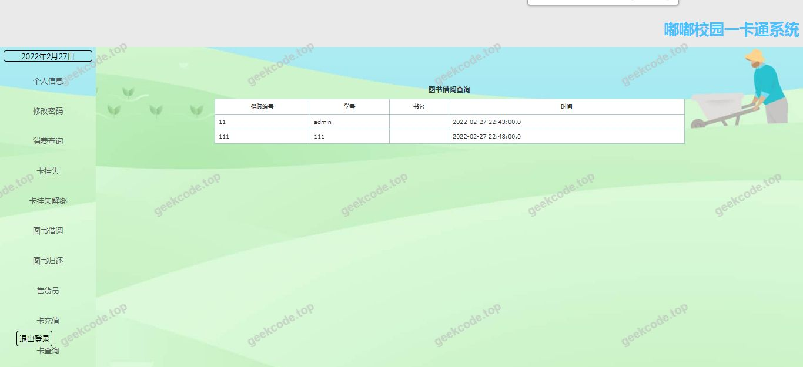

# java精品项目-基于jsp+servlet校园一卡通系统

> 🎓 **计算机毕业设计 · java精品项目-基于jsp+servlet校园一卡通系统**
>
> 本仓库只放**项目介绍 + 运行截图**（截图是站点带水印的原图，存在仓库 `images/` 里）。
>
> 👉 **完整可运行源码 / 数据库脚本 / 部署文档：[点我获取](https://geekcode.top/archives/java%E7%B2%BE%E5%93%81%E9%A1%B9%E7%9B%AE-%E5%9F%BA%E4%BA%8Ejsp-servlet%E6%A0%A1%E5%9B%AD%E4%B8%80%E5%8D%A1%E9%80%9A%E7%B3%BB%E7%BB%9F?utm_source=github)**
>
> 💬 咨询微信：**ir9372**　|　🌐 更多项目：[极客代码 geekcode.top](https://geekcode.top/?utm_source=github)
>
> 📌 项目详情页：<https://geekcode.top/archives/java%E7%B2%BE%E5%93%81%E9%A1%B9%E7%9B%AE-%E5%9F%BA%E4%BA%8Ejsp-servlet%E6%A0%A1%E5%9B%AD%E4%B8%80%E5%8D%A1%E9%80%9A%E7%B3%BB%E7%BB%9F?utm_source=github>

<table><td width="230" align="center"> <b>扫码加微信 ir9372</b></td><td valign="middle">📦 源码 = 项目介绍 + 全部运行截图 + 数据库 + 部署文档 👉 点上方任意截图，直接跳到 <b>极客代码 geekcode.top</b> 详情页</td></table>

---

<h1>java精品项目-基于jsp+servlet校园一卡通系统</h1>
<h2>项目概述</h2>

本项目名为“java精品项目-基于jsp+servlet校园一卡通系统”，旨在构建一个服务于高校场景的数字化管理平台。核心目标是通过JSP与Servlet技术栈，实现校园内各类身份认证、消费记录及权限管理的信息化处理。适用人群主要为高校学生、教职工及行政管理人员。技术架构采用经典的SSM（Spring, Spring MVC, MyBatis）框架结合JSP前端展示，后端逻辑由Servlet容器承载。尽管当前提供的上下文未包含具体的前台导航菜单或后台路由配置，但根据项目名称及截图所示的系统运行界面，该系统主要聚焦于基础的一卡通业务逻辑处理与数据展示，解决传统纸质卡管理效率低下的问题，提升校园服务便捷性。

<h2>技术架构</h2>

本项目采用分层架构设计，确保代码的可维护性与扩展性。

<ol>
<li><strong>表现层</strong>：使用JSP作为前端页面模板，负责数据的动态渲染与用户交互界面的展示。</li>
<li><strong>控制层</strong>：基于Servlet规范，处理HTTP请求与响应，协调业务逻辑调用。虽然技术栈提及SSM，但在JSP+Servlet的传统模式下，Controller层可能直接通过Servlet类或Spring MVC DispatcherServlet进行路由分发。</li>
<li><strong>业务层与服务层</strong>：封装核心一卡通业务逻辑，如卡片激活、充值、挂失等流程处理。</li>
<li><strong>数据持久层</strong>：利用MyBatis框架操作数据库，实现对象关系映射（ORM），支持对MySQL等关系型数据库的高效访问。</li>
</ol>

数据库设计方面，虽无具体表结构信息，但通常涉及用户表、卡片账户表、交易流水表及权限角色表。核心技术选型理由在于JSP+Servlet+Ssm组合成熟稳定，适合中小型Web应用开发，且符合高校计算机专业毕业设计的技术规范要求，便于理解底层Web工作原理。

<h2>功能模块</h2>

根据现有信息，无法确定具体的前台用户端与后台管理端的详细功能列表。项目基本信息中明确标注“是否有前台: 否”、“是否有后台: 否”，且“前台导航菜单”、“个人中心菜单”、“后台路由”、“前台路由”均为空。截图仅显示“系统运行界面1-5 (front)”，但未提供具体的功能按钮或菜单项描述。

因此，仅能确认系统具备基本的Web运行界面，用于展示一卡通系统的初始状态或主入口。具体的业务功能模块（如余额查询、消费记录、卡片管理等）在当前提供的代码上下文和元数据中缺失，无法进行详细列举。若需补充此部分，需提供具体的源代码文件或更详细的UI元素描述。

<h2>用户角色与权限</h2>

根据现有信息无法确定。项目资料中未提供关于管理员、教师、学生等不同角色的定义，也未列出各角色可访问的具体功能模块或权限控制策略。在缺乏后台路由配置和用户角色数据库表结构的情况下，无法梳理出完整的权限体系。通常此类系统会区分超级管理员、普通用户等角色，但本项目文档严格基于现有信息，故不推测任何未提及的角色权限细节。

<h2>项目特色与创新点</h2>

本项目的特色在于其经典的技术栈组合，即基于JSP和Servlet的传统Web开发模式，结合SSM框架的优势。这种架构对于学习Java Web底层原理具有典型意义，能够清晰展示请求-响应周期、会话管理及数据库交互过程。然而，由于缺少具体的功能描述和创新性功能亮点（如移动支付集成、大数据报表分析等），无法提炼出具体的技术创新点。项目主要价值体现在其作为教学示例或基础原型系统的完整性，而非商业层面的功能创新。

<h2>部署环境</h2>

运行本项目所需的软件环境如下：

<ol>
<li><strong>JDK版本</strong>：建议JDK 8及以上版本，以兼容SSM框架及Servlet API。</li>
<li><strong>Web服务器/容器</strong>：Apache Tomcat（推荐Tomcat 8.5或9.0版本），用于部署WAR包并运行JSP页面及Servlet组件。</li>
<li><strong>数据库</strong>：MySQL 5.7或8.0版本，用于存储一卡通相关数据。</li>
<li><strong>开发工具</strong>：IntelliJ IDEA或Eclipse，配合Maven或Gradle进行依赖管理（鉴于SSM技术栈，通常使用Maven）。</li>
<li><strong>其他</strong>：浏览器（Chrome, Edge等）用于访问系统前端界面。</li>
</ol>

注意：由于项目类型为JSP，无需Node.js环境或微信开发者工具，除非存在未提及的前端静态资源打包需求，但根据现有信息判断为纯服务端渲染架构。

<h2>五、技术特性</h2>
<ul>
<li>服务端模板渲染（JSP）</li>
</ul>
<h2>六、功能模块截图</h2>
<h3>前台用户端</h3>
<h4>系统运行界面1</h4>

<h4>系统运行界面2</h4>

<h4>系统运行界面3</h4>

<h4>系统运行界面4</h4>

<h4>系统运行界面5</h4>

---

## 获取完整源码

| 项目 | 说明 |
| --- | --- |
| 项目名 | java精品项目-基于jsp+servlet校园一卡通系统 |
| 运行截图 | 本文 5 张（站点带水印原图，仓库 `images/` 目录） |
| 完整源码 | [https://geekcode.top/archives/java%E7%B2%BE%E5%93%81%E9%A1%B9%E7%9B%AE-%E5%9F%BA%E4%BA%8Ejsp-servlet%E6%A0%A1%E5%9B%AD%E4%B8%80%E5%8D%A1%E9%80%9A%E7%B3%BB%E7%BB%9F?utm_source=github](https://geekcode.top/archives/java%E7%B2%BE%E5%93%81%E9%A1%B9%E7%9B%AE-%E5%9F%BA%E4%BA%8Ejsp-servlet%E6%A0%A1%E5%9B%AD%E4%B8%80%E5%8D%A1%E9%80%9A%E7%B3%BB%E7%BB%9F?utm_source=github) |
| 咨询微信 | **ir9372**（备注：jingpin-yuanma） |
| 更多项目 | [极客代码 geekcode.top](https://geekcode.top/?utm_source=github) |

> 需要源码、部署、改配置、跑不起来等问题，加微信 ir9372 沟通，说明项目名即可。
